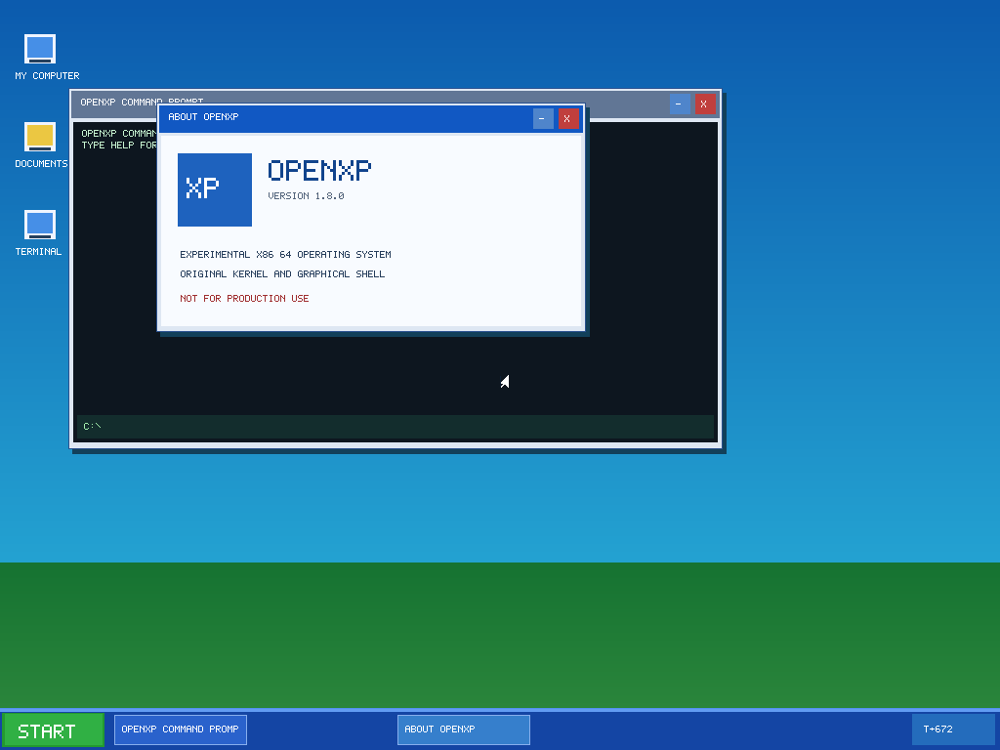

# Desktop And Apps

Consolidated from the Aurora 17 source tree. All original technical instructions are retained below, grouped by topic.

## Sections

- [VirtualBox setup](#virtualbox-setup)
- [DESKTOP](#desktop)
- [NATIVE APPS](#native-apps)

---

## VirtualBox setup

OpenXP boots as a **live ISO**. You can try it in
[Oracle VirtualBox](https://www.virtualbox.org/) without installing an OS or
creating a virtual hard disk. Its virtual hardware support is experimental;
**QEMU remains the primary testing environment**.

### Get the ISO

Build it with `make iso` (see the [README](../README.md#build-and-run)), or open your repository's **Actions** tab,
select a **Kernel Build** workflow run, and download its build artifact from
**Artifacts**. Extract the artifact ZIP and locate `openxp.iso`.

> [!NOTE]
> An uploaded ISO does not necessarily mean the full CI test suite passed.
> Check the workflow results before reporting a successful boot.

### Create a virtual machine

In VirtualBox Manager, choose **New** and use these starting settings:

| Setting | Recommended value |
| --- | --- |
| Name | `OpenXP` |
| OS type | **Other** → **Other/Unknown (64-bit)** (wording may vary) |
| Memory | **512 MB** (1 GB is fine) |
| Processors | **1 CPU** (the kernel currently targets a single CPU) |
| Firmware | **BIOS** (disable **EFI** initially) |
| Chipset | **PIIX3** |
| Pointing device | **PS/2 Mouse**, not USB Tablet |
| Graphics | **VBoxSVGA**, **32 MB** video memory, **3D acceleration off** |
| Storage | **No virtual hard disk required** |

If the new-VM wizard asks to install an OS unattended, **skip unattended
installation**. This ISO starts OpenXP directly; it is not an installer.

### Attach the ISO and boot

1. Open the VM's **Settings → Storage**.
2. Select the virtual optical drive (add one under an IDE controller if needed).
3. Choose **Select a disk file** and open `openxp.iso`.
4. In **Settings → System → Motherboard**, make sure **Optical** is first in
   the BIOS boot order.
5. Click **Start**. If boot succeeds, OpenXP should display its experimental
   desktop, taskbar, and Start menu.

The default boot image is read-only. HOME files are writable in RAM but lost at reboot.
A separate, opt-in dedicated experimental IDE disk build is described in
[Storage](FILES-AND-STORAGE.md#storage); it is not enabled in GitHub's standard ISO.
USB input, Guest Additions, networking, shared folders, and disk installation
are **not supported** by the current prototype.

### Troubleshooting

| Symptom | What to try |
| --- | --- |
| **No bootable medium** | Confirm `openxp.iso` is attached to the optical drive and **Optical** comes first in the boot order. |
| **UEFI shell or firmware screen** | Disable **EFI** and retry BIOS boot. |
| **Black screen or display problems** | Disable 3D acceleration, use **VBoxSVGA**, and retry. Compare with `make run` in QEMU. |
| **Keyboard or mouse does not respond** | Set the pointing device to **PS/2 Mouse** and click inside the VM to capture input. VirtualBox input compatibility is still experimental. |
| **Windows key doesn't open Start** | Click inside the VM so the keyboard is captured. The host or VirtualBox may intercept some shortcuts. |
| **Kernel crash or reboot** | Review the GitHub Actions QEMU smoke-test logs. A passing compile does not prove VirtualBox compatibility. |

For supported VM settings and optical-drive controls, see the
[VirtualBox user guide](https://docs.oracle.com/en/virtualization/virtualbox/7.2/user/create-vm.html).

---

## DESKTOP

## Desktop and input

OpenXP includes a small XP-inspired desktop rendered directly into a
32-bit RGB framebuffer. It is a **kernel-hosted development interface**, not
a protected userspace windowing system.



*Host-side renderer output; not a QEMU screenshot.*

### What you can do

| Feature | Interaction |
| --- | --- |
| Start menu | Two columns of built-in programs, with mouse or keyboard selection |
| Windows | Click to focus; drag title bars; minimize, maximize/restore or close |
| Taskbar | Reopen or switch built-in windows |
| Terminal | Type commands, use Enter and Backspace |
| Keyboard | Windows key opens Start; arrow keys and Enter select its items |
| File browser | XP-inspired Explorer with folders, file-type icons, associated Open actions, context menu and temporary HOME operations |
| Notepad | Edit text, Ctrl+N for new, Ctrl+S/Ctrl+O to save/open a temporary HOME file |
| WordPad | Editable text (4,095 chars), bold/zoom display, temporary HOME save/open |
| Calendar | Gregorian month grid, date highlighting from guest CMOS RTC, keyboard and pointer controls |
| Calculator | Four-operation integer arithmetic; buttons and keyboard |
| Paint | Eight-color 160 x 100 drawing surface with temporary HOME save/open |
| System Monitor | Uptime, free 4 KiB pages and open window status (not a process list) |
| Appearance | Three color schemes plus bundled BMP wallpapers, reset on reboot |
| Mines | 9 x 9, ten mines, guaranteed safe first click; right-click flags |
| Clock & Stopwatch | Stopwatch and countdown timer driven by the monotonic 100 Hz PIT tick count |
| Snake | Grid-based arcade game; use arrow keys, Space to pause, N to restart |
| Run | Launch built-in program names, or try a supported bundled `bin/` ELF |

Mouse and keyboard input use **legacy PS/2 IRQ1 and IRQ12** when i8042
initialization succeeds. The interrupt handlers queue raw bytes; the foreground
loop handles decoding and GUI events. If the controller refuses initialization,
the system falls back to PS/2 polling at the PIT interval. The serial COM1
console also feeds characters into the command interpreter. In QEMU, the normal
`make run` target shows a graphical display and uses the terminal for serial output.

### Keyboard shortcuts

| Keys | Action |
| --- | --- |
| `Win` or `Ctrl+Esc` | Toggle the Start menu |
| `↑` / `↓`, `Enter`, `Esc` | Navigate, launch, or dismiss the Start menu |
| `Win+E` | Open My Computer |
| `Win+R` | Open the Run program launcher |
| `Win+T` | Open Terminal |
| `Win+K` | Open Clock |
| `Win+Y` | Open Snake |
| `Win+N` | Open Notepad |
| `Win+C` | Open Calculator |
| `Win+P` | Open Paint |
| `Win+M` | Open System Monitor |
| `Win+S` | Open Appearance Settings |
| `Win+G` | Open Mines |
| `Win+W` | Open WordPad |
| `Win+A` | Open Calendar |
| `1`-`8`, `X` in Paint | Select a palette color, clear the canvas |
| `1`-`3` in Appearance | Select a wallpaper preset |
| Right-click or hover + `F` in Mines | Flag/unflag a hidden cell |
| `N` in Mines | Reset the board |
| Space / `R` / `M` in Clock | Start/pause, reset, toggle stopwatch/timer |
| `+` / `-` in Clock | Set countdown length from 1 to 60 minutes |
| Arrow keys / Space / `N` in Snake | Steer, pause/resume, restart |
| `Enter`, `Esc`, Backspace in Run | Launch, cancel, edit the entered command |
| `Ctrl+N` in Notepad | Clear the in-memory text (no undo) |
| `Ctrl+S` / `Ctrl+O` in Notepad, WordPad, Paint | Save/open that program's temporary HOME file |
| `Win+D` | Show desktop; press again to restore windows |
| `Alt+Tab` | Switch between open windows |
| `Alt+F4` | Close the focused window |
| `Tab` | Cycle window focus (basic legacy behavior) |
| `↑` / `↓` in Terminal | Browse command history |
| `←` / `→`, `Home` / `End` | Edit the Terminal input line |
| `Delete`, `Backspace` | Remove input characters |
| `Ctrl+C` in Terminal | Clear the current input line (not clipboard copying) |
| `Ctrl+L` in Terminal | Clear terminal scrollback |
| `↑` / `↓`, `Enter`, Backspace in My Computer | Navigate and open files or folders, go up a directory |
| `Ctrl+B`, `Ctrl+N` in WordPad | Toggle bold display; start a blank RAM document |
| `←` / `→`, `↑` / `↓`, `T` in Calendar | Previous/next month, next/previous year, return to VM date |

Notepad holds up to 2,047 characters; `Ctrl+S` writes a RAM filesystem copy
and `Ctrl+O` reopens it. Its saved file disappears when the guest shuts down. Calculator handles
nonnegative integers and shows an error on divide-by-zero, negative answers,
or overflow. Paint images can be saved temporarily in HOME, but not exported to disk.
Appearance choices are temporary as well. Mines generates ten mines after the first click
and protects that first cell. Clock uses **uptime** rather than wall-clock
or calendar time; its countdown does not play audio. Snake pauses its movement
while another program is focused. Run recognizes selected built-in aliases such
as `CMD`, `EXPLORER`, `CALC`, `CLOCK`, `SNAKE`, `NOTEPAD`, plus bundled paths
such as `BIN/HELLO`; Windows executables are not supported. All these desktop
tools run in Ring 0, **not** in separate protected processes.

WordPad holds up to 4,095 ASCII characters; toolbar bold and zoom are document-wide display settings rather than rich-text formatting. Opening a text file from My Computer copies its contents into RAM; the original read-only archive is never modified. Calendar reads the PC CMOS RTC only to select and highlight a date; UTC/local timezone interpretation depends on VM configuration, and date changes during an active session are not currently polled. Calendar does not store appointments.

The keyboard decoder currently assumes a US set-1 PS/2 layout. These shortcuts
work only when the VM passes the keys to OpenXP. The Windows key might be
intercepted by host operating-system or VM keyboard settings.

### Terminal commands

| Command | Action |
| --- | --- |
| `HELP` | List command names |
| `VER`, `UNAME` | Show basic kernel identification |
| `CLS`, `CLEAR` | Clear Terminal output |
| `ECHO hello` | Print text |
| `DIR`, `LS` | List boot and temporary RAM files |
| `CD BIN`, `CD DOCS`, `CD HOME`, `CD ..` | Change between supported virtual folders |
| `PWD` | Show current virtual directory |
| `TREE` | Show the available virtual-folder structure |
| `TYPE DOCS/README.TXT`, `CAT DOCS/README.TXT` | Read bundled text |
| `MEM`, `FREE` | Show free physical page count |
| `UPTIME` | Show PIT tick count |
| `PS` | Show the experimental process-status placeholder |
| `HISTORY` | Display recent Terminal commands (up to eight) |
| `CALC 8 * 7` | Built-in basic integer calculator (`+`, `-`, `*`, `/`) |
| `WHOAMI`, `HOSTNAME` | Display prototype user and host identity |
| `SYSINFO` | Show the CPU target, framebuffer and current limitations |
| `APPS` | Show built-in tools and instructions for running ELF samples |
| `RUN BIN/HELLO` | Attempt to launch a supported ELF64 sample application |
| `EXIT` | Minimize Terminal |

`RUN` is synchronous and uses the experimental process launcher. Program output
is sent to the **serial console**, not piped back into the graphical Terminal.
The desktop may stop responding until that program exits.

### How the desktop works

```text
PS/2 IRQ or polling fallback ─> decoded input ─> desktop and applications
COM1 serial input ───────────────────────┘              │
                                                  software renderer
                                                        │
                                                   RGB framebuffer
```

The desktop uses a software framebuffer, a cursor underlay and clipped redraws
for window dragging. Paint also repaints just the rectangle touched by its
brush; large changes still redraw more of the interface. The input subsystem
buffers raw bytes in its IRQ handlers and processes them in the foreground;
PS/2 polling is available as a fallback. The window manager currently handles
fourteen fixed built-in windows.

The implementation lives in `kernel/input/`, `kernel/video/`,
`kernel/gui/desktop.c`, and `kernel/shell/`. It has no GPU acceleration,
writable persistent filesystem or graphics process isolation.

### Verify the implementation

```bash
make test-desktop    # Shell, input, drawing and window-manager host tests
make kernel          # Compile the kernel
make run             # Attempt an interactive graphical QEMU boot
make smoke           # Headless serial-marker boot check
```

Host tests validate isolated components but **do not confirm working guest
input, drawing or application launches**. The desktop runs in Ring 0 and must
not be treated as secure. Verification goals and other planned changes are in
the [Roadmap](ROADMAP.md).

### Native application window

The Ring 3 application pilot supports up to three separate native text windows
on top of the existing desktop. Launch `RUN BIN/CALCULATOR`, `RUN BIN/CLOCK` or
`RUN BIN/NOTEPAD` from Terminal or Run, or select the program in My Computer.
Its output arrives through a checked syscall and input is queued for the app.
Native Notepad uses Ctrl+S and Ctrl+O for the temporary
`HOME/NATIVE-NOTE.TXT` file. Separate native windows have individual PID-checked
event queues. Focused keyboard input and client clicks are routed to the
respective owner. Concurrent runtime behavior still requires VirtualBox/QEMU
verification. Built-in graphical tools are still kernel-hosted. See [Native applications](DESKTOP-AND-APPS.md#native-apps).

### Temporary file operations

The kernel-hosted Terminal provides `COPY HOME/A.TXT HOME/B.TXT`,
`REN HOME/B.TXT HOME/C.TXT` and `DEL HOME/C.TXT`. These commands work only
with RAM-backed `HOME` files, never the read-only boot archive or any disk.
Copy and rename reject existing destination names and invalid paths. No
folder creation, Save As dialog or persistent storage is available yet.

### Experimental process-owned graphics

`RUN BIN/CANVAS` launches a separate native process that renders a bounded
RGB565 surface. Native Calculator, Clock and Notepad also use the same batched
pixel/bitmap-glyph ABI. The Ring 0 desktop currently composes these surfaces
into the native window slots. These native programs and their mouse/keyboard
handling still require end-to-end VM verification. The older built-in tools
remain available and are not yet migrated out of Ring 0.

### Native application migration

Calendar, Mines, Snake, System Monitor and About join the previously bundled
Calculator, Clock, Notepad and Canvas as independent ELF64 applications.
Start and shortcuts prefer the native Calendar, Mines and Snake alongside
Calculator and Notepad; the other standalone demos remain opt-in via Run or
Terminal until their missing legacy features are ported. A full three-window
native broker triggers a legacy fallback instead of silently failing.

- `RUN BIN/CALENDAR`: arrows change month/year, click selects a day, T returns
  to today's RTC date if available.
- `RUN BIN/MINES`: left click reveals, right click flags, N restarts.
- `RUN BIN/SNAKE`: arrow keys steer, Space pauses/starts, N restarts.
- `RUN BIN/MONITOR`: read-only uptime and available physical page count.
- `RUN BIN/ABOUT`: informational window.

These windows now have a bounded 640×360 RGB565 backing store and a logical
canvas that expands with their size instead of always stretching 320×180. Native
app drawing and pointer hit areas reflow after the `OXP_RESIZE` event. There
is still no GPU acceleration. Native graphics and input require VM testing.

### Native migration update

The Start menu now attempts Ring 3 versions of Paint, WordPad, Terminal,
File Manager, Run and Appearance Settings; Ring 0 equivalents are retained as
fallbacks while guest verification and feature parity are incomplete.

- **Native Settings:** select one of three schemes for a live `windowd`
  wallpaper/taskbar change. Save writes `home/appearance.cfg` to RAM; values
  disappear when the VM powers down unless experimental storage is enabled.
- **Native File Manager:** `C` copies a selected file to HOME (using `.copy`
  for HOME-to-HOME copies), `R` starts a new-filename prompt on HOME files,
  `D` deletes a HOME file, and `O` or Enter previews/opens.
- **Native Terminal:** `LS`, `CAT`, `RUN`, `MEM`, `UPTIME`, `COPY`, `REN`,
  `DEL`, `WRITE` and `TOUCH`. `COPY docs/readme.txt home/readme.txt` is a
  useful example. Commands and filenames are intentionally length-limited.
- **Native Paint:** 64x40 pixels with eight colors and OXP2 save data; the
  previous OXP1 drawing format is imported. Drawing is still click-based.
- **Native WordPad:** limited cursor insertion/deletion and whole-document
  zoom/bold; not a fully featured rich-text editor.

Final pixel rendering and legacy window controllers still run in Ring 0.
Moving those out requires a separately tested userspace compositor and full
application parity; the fallback must remain available until then.

### XP-style file browsing

The native File Manager now shows **immediate children** of `C:\` folders,
instead of a flat list of every boot file. Use Enter or click an already
selected folder to open it, Backspace or the Up control to return to its parent,
and Enter on supported `.exe` entries to request an OpenXP Ring 3 launch.

The built-in system folders and wallpaper asset path are explained in
[Filesystem and wallpapers](FILES-AND-STORAGE.md#filesystem). The native Terminal supports
`CD`/`DIR` navigation, and Run accepts supported app names and `.exe` aliases.

For current native file associations, Explorer controls, and custom image requirements, see [Explorer and wallpapers](FILES-AND-STORAGE.md#explorer).

### Window sizing

Every legacy and native application window has three title-bar controls: **Minimize**,
**Maximize/Restore** and **Close**, arranged left-to-right as in Windows XP.
Maximizing uses the screen area above the taskbar. Click the middle button again
to return to the saved window dimensions and location. Minimized maximized
windows remain maximized when restored through the taskbar.

The Ring 3 desktop also supports **Win+Up** to maximize and **Win+Down** to
restore (or minimize when already in the normal state). The native SDK now
reports the logical canvas dimensions and emits resize events whenever they
change; the principal native applications reflow their content and click targets.
The recovery desktop keeps the same title-bar controls.

---

## NATIVE APPS

## Native OpenXP applications

The native application pilot separates freestanding x86-64 programs from the
kernel. The installer, dynamic libraries and Windows PE `.exe` loader have **not**
been implemented. All current native files use a custom, constrained ELF64
profile inside the read-only `OXRD` boot archive.

### Current programs

| Source | Image path | Function |
| --- | --- | --- |
| `apps/native/calculator.c` | `bin/calculator` | Integer keyboard calculator |
| `apps/native/clock.c` | `bin/clock` | PIT uptime display |
| `apps/native/notepad.c` | `bin/notepad` | Editable note with temporary RAM saving |
| `apps/native/probe.c` | `bin/probe` | Synchronous GUI and RAM-file ABI smoke probe |
| `apps/native/waitprobe.c` | `bin/waitprobe` | Preemptible Ring 3 GUI wait and timeout smoke probe |
| `apps/native/windowd.c` | `bin/windowd` | Trusted Ring 3 shell/window-policy service with IPC and bounded drawing commands |
| `apps/native/winclient.c` | `bin/winclient` | Separate Ring 3 client that connects to the window service |
| `apps/native/canvas.c` | `bin/canvas` | Demonstrates independent process-owned pixel drawing and click events |
| `apps/native/calendar.c` | `bin/calendar` | Gregorian date navigation; VM RTC date via read-only syscall |
| `apps/native/mines.c` | `bin/mines` | First-click-safe Mines with keyboard reset and right-click flags |
| `apps/native/snake.c` | `bin/snake` | Independent timer-driven game with arrow controls |
| `apps/native/monitor.c` | `bin/monitor` | Read-only free-page count and uptime |
| `apps/native/about.c` | `bin/about` | Isolated informational window |
| `apps/native/paint.c` | `bin/paint` | Eight-color 64×40 canvas, OXP2 save/open and OXP1 import |
| `apps/native/wordpad.c` | `bin/wordpad` | Bounded text editor, 100%/200% view and RAM document |
| `apps/native/terminal.c` | `bin/terminal` | Independent terminal with a small set of commands |
| `apps/native/filemanager.c` | `bin/filemanager` | Boot/HOME file browser, text preview and application launch |
| `apps/native/run.c` | `bin/run` | Allowlisted application launcher |
| `apps/native/settings.c` | `bin/settings` | Theme selection through windowd's IPC and RAM-backed preference file |


See [Process IPC and window service](CORE-ENGINEERING.md#ipc) for the handle model,
service authorization, syscall arguments and optional QEMU smoke test.

The earlier `bin/hello` and `bin/fault` are still independent assembly-only
ELF64 examples. Older implementations are retained as compatibility fallbacks.
Paint, WordPad, Terminal, File Manager, Run and Settings now also have
independent experimental executables. The older, more complete Ring 0
versions remain available if native launch fails; the Start menu now prefers
native counterparts, although VM verification and full parity remain pending. The monitor shows live memory and uptime only, not
a complete process table. The native Clock remains an uptime display, not
feature-parity with the older stopwatch/countdown tool.

### Build and boot

```bash
make kernel            # Builds native apps and packages them into openxp.elf
make test-unit         # Host-side regression tests
make test-sanitize     # Memory/UB checks on supported host components
make smoke-native      # Native Ring 3 ABI boot test (requires QEMU/Limine)
make iso               # Bootable disc image (requires Xorriso/Limine)
```

Use **Run** or **Terminal** to launch `BIN/CALCULATOR`, `BIN/CLOCK`,
`BIN/NOTEPAD`, `BIN/CANVAS`, `BIN/CALENDAR`, `BIN/MINES`,
`BIN/SNAKE`, `BIN/MONITOR`, `BIN/ABOUT`, `BIN/PAINT`, `BIN/WORDPAD`,
`BIN/TERMINAL`, `BIN/FILEMANAGER`, `BIN/RUN`, or `BIN/SETTINGS`. They can now be launched concurrently, limited by the
experimental process/scheduler and three-window capacities (host-tested;
interactive VM verification is outstanding). My Computer also lists the files under BIN. The programs are
prebuilt into the read-only ISO, not installed on a persistent disk.

### User ABI

A program enters at `_start` with a mapped, writable private user stack and
invokes `int 0x80`: syscall number in `RAX`, arguments in `RDI` and `RSI`,
result in `RAX`. The kernel validates user address ranges and copies bounded
buffers through the process address-space mapping.

| Number | Operation | Result |
| --- | --- | --- |
| 6 | `GUI_OPEN(user_title, title_len)` | Open one of three PID-owned windows; 0 on success |
| 7 | `GUI_TEXT(user_text, text_len)` | Update native text content; 0 on success |
| 8 | `GUI_EVENT()` | Nonblocking event: ASCII, 8 Backspace, 10 Enter, 27 Escape, `0x10000` close, `0x10001` Ctrl+S, `0x10002` Ctrl+O, bit 31 left-click, bit 30 right-click, or `0x10003..0x10006` directional keys, or `0x10007` canvas-resize |
| 9 | `RAM_READ(user_buf, max_size)` | Byte count or negative error; fixed temporary note path |
| 10 | `RAM_WRITE(user_buf, size)` | Byte count or negative error; fixed temporary note path |
| 11 | `GUI_DRAW(user_commands, count)` | Atomically validate and draw 1–32 fixed-size commands to the calling PID's private surface; 0 or negative error |
| 12 | `GUI_WAIT(timeout_ticks)` | Atomically dequeue or block until a GUI event; `0` waits indefinitely, positive values set a timer deadline; `0` result means timeout (or unavailable scheduler) |
| 25 | `RTC_DATE()` | Packed date (year << 16, month << 8, day), or zero if RTC unavailable |
| 26 | `FREE_PAGES()` | Read-only free 4 KiB physical page count |
| 27 | `FS_OP(operation, request*)` | Bounded named-file list/read/write/rename/delete/kind; 1,024-byte transfer maximum |
| 28 | `APP_LAUNCH(path*, length)` | Queue an allowlisted bundled application to launch from the boot thread; 0 means queued, not yet started |
| 33 | `GUI_CANVAS_SIZE()` | Owner-only current logical width in high 32 bits and height in low 32 bits; 0 if no native window |

The new game/calendar logic lives in `apps/native/game_logic.h` with host-side
regression tests (`make test-native-games`). The boot archive now supports 32 records, with 22 entries in the current
build. Validation still checks record boundaries, CRC32, names and duplicates.

Native app source includes `apps/native/oxp.h`. A tiny `_start` assembly stub
calls `oxp_main()` with the expected System V AMD64 C stack alignment. The
freestanding runtime supplies the required memory primitives without a libc.
The linker creates a relocation-free native binary, and `tools/mkinitrd.py`
wraps it as `ET_DYN` ELF64 with a bounded executable segment plus separate
zero-initialized writable pages for native `.bss`. This keeps W^X rather
than putting application state in writable executable memory. Initialized
mutable data, dynamic relocations, shared libraries and ordinary Linux/Windows
programs remain unsupported. **Actual VM execution of the new layout still
requires confirmation.**

### Security and compatibility boundaries

- Up to **three** simultaneous PID-owned native windows, each with an
  independent bounded **640×360 RGB565** backing allocation and/or text content.
  The visible logical canvas grows with the window size, preserving the
  client aspect ratio and nearest-neighbour scaling. Normal-size apps use
  approximately 320×180; a maximized client can use more drawing pixels. The app queries its current canvas with
  `oxp_canvas_width()` / `oxp_canvas_height()`.
  The owner is checked for updates and event reads; exit/fault releases its
  window. The fourth concurrent `GUI_OPEN` fails cleanly.
- Input follows window focus, and client mouse click events encode window-local
  x in bits 10–19 and y in bits 0–9, with bit 31 set. Coordinates include
  the window decorations. Dragging the bottom-right grip and maximizing/
  restoring both resize the logical canvas. Native apps receive `OXP_RESIZE`
  only when its logical dimensions change; event-driven apps should repaint.
- Drawing commands support **clear**, **filled rectangle**, and **5×7 glyph**
(scale 1–2) operations, with colors `0x00RRGGBB`. The kernel copies and
validates each bounded syscall batch before updating an owner-only surface;
applications never receive a direct framebuffer pointer. `apps/native/oxp.h`
provides `oxp_draw`, `oxp_fill`, and `oxp_label` helpers. This is a small
**native graphics ABI prototype**, not a stable SDK or separate Ring 3 compositor.

- The separate process runs with its own CR3, Ring 3 mappings, and guarded
  user and kernel stacks. Hardware-enforced behavior requires VM testing.
- Window-manager drawing and existing built-in apps still run in Ring 0.
- Native applications now use `oxp_wait()` for scheduler-backed event waits.
  The queue check and park are atomic under disabled local interrupts, and
  GUI delivery wakes the waiting thread. Calculator, Notepad and Canvas wait
  until an event arrives; Clock uses a bounded timeout to repaint the time.
  GUI_CLOSE is a sticky signal even when the input FIFO is full. The older
  `GUI_EVENT` nonblocking syscall remains available.
- The wait path needs real QEMU/VirtualBox verification (`make smoke-native-wait`).
  The separate wait boot test launches a preemptible Ring 3 waitprobe, which exercises a
  timed GUI_WAIT while timer interrupts are enabled. The test does not prove
  a fully protected Ring 3 window server or a complete desktop migration.
- Older native builds used busy-polling loops, so native programs could consume
  CPU even when idle; the scheduler remains experimental.
- The legacy note API still exists. The new bounded `FS_OP` interface accepts
  a 48-byte NUL-terminated path and 1,024 data bytes per call. Reads/listing
  use the VFS; writes/renames/deletes target `home/` only. `APP_FS_COPY` (7)
  copies files into HOME, including immutable boot files up to RAMFS capacity,
  but cannot overwrite a destination or modify the boot archive.
  Files are RAM-only by default and there is no per-user access control model.
- The launch queue accepts only a hardcoded list of boot-archive applications,
  excluding the window service, fault probes and arbitrary executable paths.
  It is a one-slot queue and may be busy. This is NOT a general executable
  loader, installer or sandboxed process-spawn ABI.
- Native Paint now uses eight colors but a smaller 64x40 canvas, and still
  lacks the legacy free-drag painting behavior; its `OXP2` format accepts
  existing `OXP1` four-color files. Native WordPad supports cursor editing,
  RAM save/open and whole-document zoom/bold display, not rich formatting.
  Native Terminal supports HOME file creation, copying, renaming and deletion;
  File Manager has keyboard-driven copy, rename and delete. Native Settings
  sends bounded `WM_THEME` requests through IPC to `windowd`, which chooses
  wallpaper/taskbar colors and synchronizes fallback appearance. Preferences
  are RAM-only and all native operations still need VM tests.
  **Full native functional parity has not been reached.**
- The loader accepts restricted static ELF64, not Microsoft PE `.exe`.
- No guarantees of robustness, sandbox security or VirtualBox behavior until
  the integration tests have passed on the actual ISO.

The remaining migration work is tracked in [Roadmap](ROADMAP.md).

---
